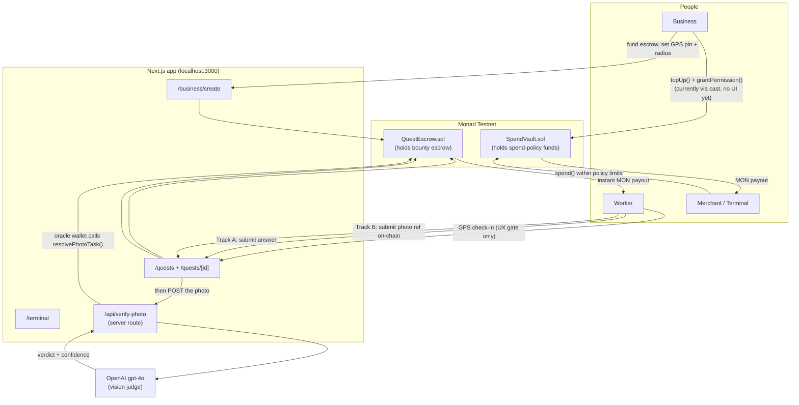
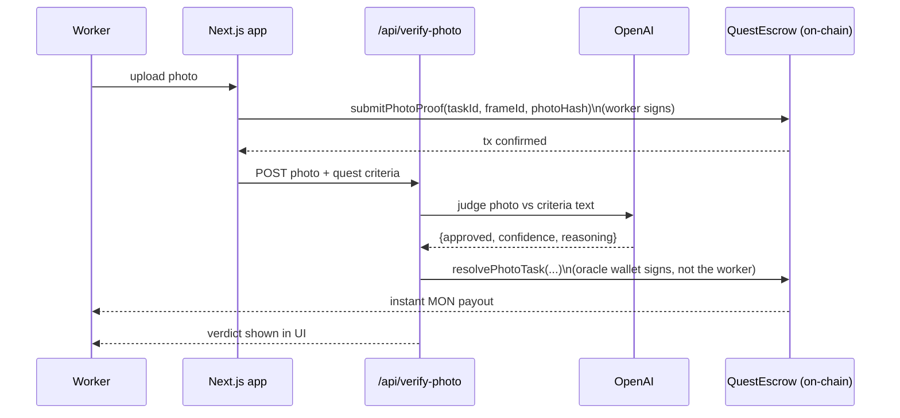

# BountyDrop

A location-based micro-bounty platform on **Monad Testnet**. Businesses post
tasks pinned to a real GPS location and fund them with native MON up front;
workers physically show up, check in, submit proof, and get paid **instantly
and on-chain** the moment their submission is verified — no backend decides
who gets paid, the smart contract does.

## Why this exists

This was synthesized from three separate earlier projects — `MicroWorks`
(instant golden-key payouts), `TapPay` (NFC-style local spend), and `SattelR`
(restricted spend policies/guardrails) — via a clean-room spec
(`BOUNTYDROP_MASTER_SPEC.md`) and build prompt (`BOUNTYDROP_BUILD_PROMPT.md`),
both in this repo root. The idea: a worker should be able to **earn** MON
from a real-world task *and* **spend** it locally with built-in budget
guardrails, without either side ever touching the other's private key. That's
the two-contract system below — `QuestEscrow` for earning, `SpendVault` for
spending.

## How it works — architecture



**Track A (golden-key, deterministic)** — for yes/no, multiple-choice,
rating, or exact-text answers. The business commits a `keccak256` "golden
answer" on-chain at creation. A worker's submission is hash-compared in a
single transaction; a match pays out immediately, in the same call.

**Track B (AI-judged photo proof)** — for anything that can't be reduced to
one pre-known answer. The worker registers their photo claim on-chain first
(just a hash, the image itself is never on-chain), then the app's server
route sends the actual photo to OpenAI's `gpt-4o` along with the business's
exact proof-criteria text. If approved (≥70% confidence), the server — acting
as the contract's designated oracle wallet — submits the verdict on-chain
itself, triggering the payout with no second signature needed from the
worker.



**GPS is a UX gate, not a security boundary.** `CheckInButton.tsx` and the
quest detail page say this explicitly in the UI copy, and neither contract
re-verifies device location on-chain — browser geolocation is trivially
spoofable, so it only unlocks the submission form, it never gates the
payout itself. The Haversine distance check (`lib/geo/haversine.ts`) is real
math, just not a trust boundary.

## Tech stack

- **Frontend**: Next.js 14 (App Router) + TypeScript + Tailwind, `wagmi` +
  `viem` for all chain reads/writes, `react-leaflet`/`leaflet` for the quest
  map, `@splinetool/react-spline` for the landing-page 3D hero.
- **No database, anywhere.** Every piece of UI state — quest lists, claims,
  balances, spend policies — is read live from the contracts via
  `useReadContract`/`useReadContracts`, polled every few seconds. There is no
  backend cache to go stale; what you see is always a direct on-chain read.
- **Contracts**: Foundry (`solc 0.8.24`, `optimizer runs=200`, `viaIR=true`).
  `QuestEscrow.sol` (escrow + two-track verification) and `SpendVault.sol`
  (restricted MON spend policies — budget cap, category, address-based
  merchant allowlist, expiry, single-use flag, optional on-chain geofence).
- **AI vision judge**: `app/api/verify-photo/route.ts`, server-side only,
  calls OpenAI's `gpt-4o`.
- **Design system**: everything under `components/ui/` — `Reveal` (scroll-in
  animation), `ScrambleText` (hover letter-scramble), `useCountUp`, and glass
  card/button primitives. Deliberately **zero animation library** (no
  framer-motion) — pure CSS transitions + `IntersectionObserver` /
  `requestAnimationFrame`, to avoid adding heavy new npm dependencies this
  close to a deadline.

## Repo layout

```
app/                    Next.js App Router pages
  page.tsx                landing page
  quests/                 worker-facing: map + list, quest detail/check-in/submit
  business/                business-facing: dashboard + create-quest form
  terminal/                Spend Terminal redemption UI
  api/verify-photo/        server route calling the AI vision judge
components/              React components (forms, map, nav, ui/ design system)
hooks/useUserLocation.ts  browser geolocation wrapper
lib/                     chain config, ABI, geofencing math, error decoding
contracts/               Foundry project
  src/QuestEscrow.sol      bounty escrow + two-track verification
  src/SpendVault.sol       restricted spend-policy vault
  test/                    Foundry test suite (19 tests, all passing)
  script/Deploy.s.sol      deploy script
scripts/gen-abi.mjs      regenerates lib/abi.ts from Foundry build artifacts
```

## Prerequisites (one-time machine setup)

1. **Node.js 18+** — https://nodejs.org
2. **Git Bash** (ships with Git for Windows) or WSL — `foundryup` installs
   `forge`/`cast`/`anvil` into your bash profile's PATH, **not** the Windows
   system PATH, so PowerShell/cmd won't see them. Use Git Bash for every
   `forge`/`cast` command below. https://git-scm.com/download/win
3. **Foundry** — https://book.getfoundry.sh/getting-started/installation
   ```bash
   curl -L https://foundry.paradigm.xyz | bash
   # restart your shell, then:
   foundryup
   ```
4. **MetaMask** — https://metamask.io/download/
5. **Add Monad Testnet to MetaMask** (network dropdown → Add network manually):

   | Field | Value |
   |---|---|
   | Network Name | Monad Testnet |
   | RPC URL | `https://testnet-rpc.monad.xyz` |
   | Chain ID | `10143` |
   | Currency Symbol | `MON` |
   | Block Explorer | `https://testnet.monadexplorer.com` |

   Reference: https://docs.monad.xyz/developer-essentials/network-information
6. **Get testnet MON** — https://faucet.monad.xyz
7. **OpenAI API key** (only needed for Track B to actually resolve) —
   https://platform.openai.com/api-keys

## Setup from scratch

```bash
git init                      # only if the folder isn't already a git repo
cd contracts
forge install foundry-rs/forge-std --no-commit
cp .env.example .env
```

Edit `contracts/.env`:
```
PRIVATE_KEY=0x<your deployer wallet's private key>
# PHOTO_ORACLE_ADDRESS can be left blank — it defaults to the deployer
# address (see Deploy.s.sol), so one wallet can do everything for testing.
```

```bash
source .env
forge test -vvv               # should print: 19 tests passed, 0 failed
forge script script/Deploy.s.sol \
  --rpc-url monad_testnet \
  --broadcast \
  --private-key $PRIVATE_KEY
```

Copy the two printed addresses, then from the repo root:

```bash
cd ..
cp .env.example .env.local
```

Edit `.env.local`:
```
NEXT_PUBLIC_QUEST_ESCROW_ADDRESS=<QuestEscrow address from above>
NEXT_PUBLIC_SPEND_VAULT_ADDRESS=<SpendVault address from above>
NEXT_PUBLIC_PHOTO_ORACLE_ADDRESS=<your wallet address>
OPENAI_API_KEY=sk-...
PHOTO_ORACLE_PRIVATE_KEY=0x<your same deployer private key>
```

```bash
npm install     # see Troubleshooting below if this is extremely slow
npm run gen-abi
npm run dev
```

Open http://localhost:3000, connect MetaMask (confirm it's switched to Monad
Testnet).

**Example deployment** (from my own test run, for reference — redeploying
gives you fresh addresses):
- `QuestEscrow`: `0xFe50397de081EbA91E02f0d1fea2F5f175048C97`
- `SpendVault`: `0x5BaC9e18a1bdb417A0b398a77663e0769dE4F0E9`

## How to post a bounty

1. Go to `/business/create`, connect a wallet funded with testnet MON.
2. Fill in **Title** and **Description** — for Track B, Description doubles
   as the exact proof criteria text sent to the AI judge, so be specific
   (e.g. *"Photo must show the shelf fully stocked, no empty gaps visible"*,
   not just *"check the shelf"*).
3. Pick **Verification**:
   - Track A kinds (Multiple choice / Yes-No / Rating / Free text) need a
     **golden answer per frame**, one per line, as the **0-based index** of
     the correct option (`$3, $4, $5` → index `1` = `$4`; `Yes/No` → index
     `1` = Yes; Rating buttons `1`–`5` → index `0`–`4`, so "a rating of 4 is
     correct" is golden answer `3`, not `4`). The line count must exactly
     match **Number of frames**, or the form blocks submission.
   - Track B (Photo proof) needs no golden answers at all — resolution comes
     from the AI judge.
4. **Number of frames** = how many separate times this bounty can be
   claimed. Keep it at `1` unless you specifically want multiple independent
   claims. Reward × frames = total escrow you're funding up front.
5. **Geofence radius** — a UX gate for check-in, not re-verified on-chain.
6. **Click the map** to drop the quest's pin. Note the exact lat/lng shown
   below the map — you'll need it to check in as a worker (next section).
7. Submit → MetaMask prompts a transaction funding the escrow → confirm.

**Important**: the form does **not** reset between submissions — if you post
a second bounty without changing fields, you'll get a duplicate quest and
double-spend escrow. Change at least the title before resubmitting, and wait
for the MetaMask prompt to actually appear before clicking "Post bounty"
again.

## How to claim a bounty (as a worker)

Real GPS won't match a bounty you posted from your desk, so testing requires
spoofing your browser's location to match the quest's pin:

1. Go to `/quests`, open the bounty you want to claim.
2. **Get the quest's exact coordinates.** The map pin position shown under
   the map at creation time is a rounded display value — for a reliable
   match, read the exact on-chain value instead:
   ```bash
   cast call <QUEST_ESCROW_ADDRESS> \
     "getTask(uint256)(uint256,address,string,string,string,uint8,uint8,string[],uint256,uint256,uint256,uint256,uint256,bool,int256,int256,uint32)" \
     <taskId> --rpc-url monad_testnet
   ```
   The two `int256` values near the end are `latE7`/`lngE7` — divide each by
   `10000000` to get decimal degrees (e.g. `407145231` → `40.7145231`).
3. **Spoof your location** (desktop Chrome only — this does not work on
   mobile browsers, and a phone's `localhost:3000` is a different device
   than your dev machine's):
   - Open DevTools (`F12`)
   - **⋮ (top right of DevTools) → More tools → Sensors**
   - Under "Location," select **"Other..."** and enter the exact latitude
     and longitude from step 2
   - Reload the quest page
4. Once the page shows you're within the radius, click **Check in**.
5. Submit proof:
   - **Track A**: click the matching option — if it matches the golden
     answer, you'll see "Correct! X MON paid out instantly" after the
     MetaMask transaction confirms. A wrong answer shows "Not quite," costs
     no funds, and you can retry the same frame.
   - **Track B**: upload a photo. First MetaMask confirms a transaction
     registering your claim on-chain, then the UI shows "Verifying with AI
     vision judge..." while the server calls OpenAI, then an approved/
     rejected card with reasoning and confidence %. If approved, the payout
     is submitted automatically by the server's oracle wallet — **no second
     MetaMask prompt**, that's expected, not a bug.

To test as a genuinely different person (not just your own wallet playing
both roles), switch MetaMask to a **second account** before checking in and
submitting — the contract has no restriction on creator and claimant being
different wallets; that's the actual designed flow.

## Spend Terminal (secondary feature, partially manual)

`SpendVault` lets an owner grant a vendor/terminal wallet a capped,
categorized, allowlisted, optionally-geofenced MON spend policy — the
terminal can redeem against it without ever holding the owner's key. The
`/terminal` page is the **redemption** side and is fully built. There is
currently **no UI for the owner side** (`topUp()` / `grantPermission()`) —
do it via `cast`:

```bash
cast send <SPEND_VAULT_ADDRESS> "topUp()" --value 0.1ether \
  --rpc-url monad_testnet --private-key $PRIVATE_KEY

cast send <SPEND_VAULT_ADDRESS> \
  "grantPermission(address,uint256,string,address[],uint256,bool,bool,int256,int256,uint32,uint256)" \
  <TERMINAL_WALLET_ADDRESS> 100000000000000000 "food" "[<MERCHANT_ADDRESS>]" 0 false false 0 0 0 0 \
  --rpc-url monad_testnet --private-key $PRIVATE_KEY
```

Then connect the terminal wallet at `/terminal` — the granted policy appears
in the dropdown.

## Known limitations (honest, not hidden)

- **`SpendVault` is single-owner, one global instance.** `owner` is
  `immutable`, set to whoever deploys it; `Deploy.s.sol` deploys exactly one
  vault for the whole app. Only that one deployer address can ever call
  `topUp()`/`grantPermission()` — this is not yet multi-tenant, despite the
  UI copy reading as if any business could run their own vault. A real
  multi-tenant version needs a `SpendVaultFactory` (deploy-your-own, like
  SattelR's original pattern) or an explicit decision that BountyDrop runs
  one platform-owned vault for everyone.
- **`SpendVault`'s on-chain geofence** avoids Solidity trig/sqrt via a
  flat-earth squared-distance approximation, with meters-per-degree-longitude
  precomputed *off-chain by the policy grantor* and passed in at
  `grantPermission()` time. Accurate at the tens-to-hundreds-of-meters radii
  this product uses; would need real trigonometry (or an oracle) at larger
  scales. Documented in the contract's own NatSpec.
- **"Next open frame" heuristic.** The quest detail page submits against
  `frameId = task.completed` — the simplest behavior for one worker at a
  time; a real multi-worker product would want the contract or an indexer to
  hand out frame assignments instead.
- **No database, no indexer.** Great for trustlessness, bad for scale —
  listing quests means reading `taskCount()` then batch-fetching every
  `getTask(i)`; fine at dozens of quests, will get slow in the hundreds.
  There's also no "my history" view — everything shown is current contract
  state, not a log of past activity.
- **GPS check-in is spoofable by design** (see "How it works" above) — this
  is explicit product copy, not an oversight.

## Bugs found and fixed during testing (kept here as project history)

The original AI-generated build compiled cleanly and type-checked with zero
errors, but several real bugs only surfaced once the Foundry test suite was
actually *run* (it hadn't been, originally — no sandbox network access) and
once the app was actually clicked through end-to-end:

1. **`contracts/test/QuestEscrow.t.sol`**: `testCannotClaimFrameTwice`
   asserted the wrong revert (`NoAnswerKey` instead of the real
   `FrameAlreadyClaimed`) — the golden-answer hash is never cleared after a
   successful claim, so a second matching submission trips the
   already-claimed guard, not the no-answer-key one.
2. **Foundry `vm.prank`/`vm.expectRevert` consumed by the wrong call**: every
   test calling `escrow.createTask(..., escrow.KIND_YESNO(), ...)` inline
   had the prank/revert-expectation land on that inline getter call (itself
   an external call, evaluated first), not on `createTask`. Fixed by reading
   the `kind` constant into a local variable *before* the prank line, in
   every affected test.
3. **`SpendVaultTest` had no `receive()`**: the test contract deployed the
   vault as itself, but couldn't accept the MON `withdraw()` sent back to
   it, causing a spurious `TransferFailed()`. Fixed by adding
   `receive() external payable {}` to the test contract.
4. **Wrong AI model ID**: `lib/verification/photoJudge.ts` originally called
   a nonexistent Anthropic model string; switched to OpenAI `gpt-4o` to match
   the API key actually available.
5. **`lib/errors.ts` was missing ~13 custom-error mappings** (`BadFrameCount`,
   `EscrowTooSmall`, `ZeroAddress`, `NotAgent`, etc.) — they fell through to
   a generic "Something went wrong" instead of a specific message.
6. **Quest detail page hid its own payout confirmation.** The
   proof-submission component was only rendered while `t.active` was true;
   the moment a single-frame quest got fully claimed, the next 6-second poll
   flipped `active` to false and unmounted the "Approved — payout sent" card
   before you could read it. Fixed by keeping the submission UI mounted once
   `checkedIn` is true, regardless of what `active` does afterward.
7. **Golden-answer line-count footgun**: `BusinessQuestCreatorForm` used to
   silently reuse line 1 for any frame beyond what you'd typed, instead of
   erroring — now it blocks submission with a clear message if the line
   count doesn't exactly match the frame count.

## If you're coming back to this in a year

Start here, in order: read the two spec docs in the repo root
(`BOUNTYDROP_MASTER_SPEC.md` for where each piece of logic came from,
`BOUNTYDROP_BUILD_PROMPT.md` for the original build brief), then read
`contracts/src/QuestEscrow.sol` and `contracts/src/SpendVault.sol` top to
bottom — both are short, heavily NatSpec'd, and are the actual source of
truth for what this product does (the frontend is just a view over them).
Run `forge test -vvv` before touching anything to confirm the baseline still
holds, then follow "Setup from scratch" above on a fresh machine to
rebuild muscle memory for the whole flow.

## Troubleshooting

- **`npm install` is extremely slow (10+ minutes)**: almost always Windows
  Defender real-time-scanning every file as it's written, or a genuinely
  slow connection to the npm registry (check for 100+ second fetch times in
  `npm-cache/_logs/*.log` if it's really bad). Add a Defender exclusion for
  the project folder, and run `npm install` from **PowerShell**, not Git
  Bash — Git Bash's MinGW layer adds real per-process overhead on Windows
  that native PowerShell doesn't have.
- **`'forge'`/`'foundryup'` not recognized**: you're in PowerShell/cmd, but
  `foundryup` only adds itself to your **bash** profile. Use Git Bash for
  all `forge`/`cast` commands.
- **`forge install` fails with "not a git repository"**: run `git init` in
  the repo root first — `forge install` uses `git submodule` under the hood.
- **`forge script` fails with "missing hex prefix"**: your `PRIVATE_KEY` in
  `contracts/.env` needs a `0x` prefix — MetaMask's exported key doesn't
  include one by default.
- **MetaMask shows `0 MON` / "insufficient funds" but the block explorer
  shows a real balance**: you're very likely connected to the wrong network
  entry in MetaMask (e.g. an old "Monad Mainnet" from a different project,
  chain ID `143`, instead of "Monad Testnet", chain ID `10143`) — check
  Settings → Networks → the chain ID field of each "Monad"-named entry.
