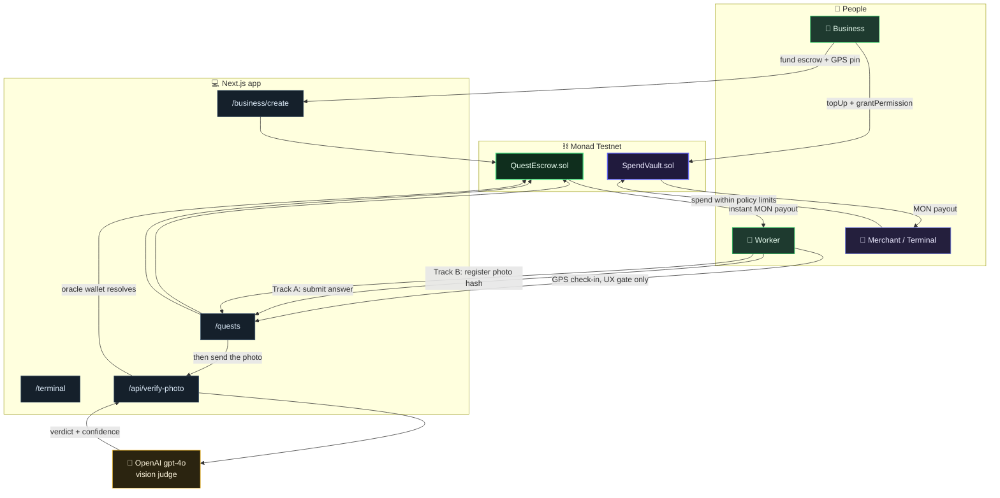

# 📍 BountyDrop

<div align="center">

**Real-world micro-bounties, settled instantly on-chain — no backend decides who gets paid.**

[](https://nextjs.org/)
[](https://www.typescriptlang.org/)
[](https://soliditylang.org/)
[](https://book.getfoundry.sh/)
[](https://monad.xyz/)

*A location-based gig economy, enforced by a smart contract instead of a platform you have to trust.*

[Overview](#-overview) • [How It Works](#-how-it-works) • [Tech Stack](#%EF%B8%8F-tech-stack) • [Run It Yourself](#-run-it-yourself-from-scratch) • [Project Structure](#-project-structure)

</div>

---

## 🌐 Deployment

| | |
|---|---|
| **Network** | Monad Testnet (chain ID `10143`) |
| **Explorer** | <https://testnet.monadexplorer.com> |
| **Example `QuestEscrow`** | [`0xFe50397de081EbA91E02f0d1fea2F5f175048C97`](https://testnet.monadexplorer.com/address/0xFe50397de081EbA91E02f0d1fea2F5f175048C97) |
| **Example `SpendVault`** | [`0x5BaC9e18a1bdb417A0b398a77663e0769dE4F0E9`](https://testnet.monadexplorer.com/address/0x5BaC9e18a1bdb417A0b398a77663e0769dE4F0E9) |
| **Run it locally** | [Run It Yourself](#-run-it-yourself-from-scratch) |

Every bounty, every claim, every payout is a transaction on that contract —
nothing shown in the app is read from a database, because there isn't one.

---

## 📖 Overview

**BountyDrop** is a location-based micro-bounty platform. A business pins a
task to a real GPS location and funds it with native MON up front. A worker
physically shows up, checks in, submits proof, and gets paid **the moment
it's verified** — in the same transaction, no multi-day review queue, no
platform fee dispute, no backend deciding anything.

### 🎯 The problem it explores

Most task/gig platforms are opaque middlemen:
- Payouts are **delayed**, pending manual review
- "Proof" is whatever a support ticket says it is
- The platform itself is the trust anchor — you're trusting *them*, not math
- There's no way to independently verify a payout actually happened fairly

### ✨ The approach

- **Two verification tracks**, same contract, same instant settlement:
  a deterministic on-chain hash-match for objective facts, and an AI vision
  call for anything that needs real visual judgment
- **GPS is honest about what it is** — a convenience gate for the UI, stated
  explicitly in the product copy as *not* a security boundary, because
  browser geolocation is trivially spoofable and pretending otherwise would
  be a lie
- **Zero database** — every number in the UI is a live contract read
- **A second contract closes the loop**: earn MON from a task, then spend it
  locally through a guardrailed vault (capped budget, category, merchant
  allowlist) without the vendor terminal ever touching your private key

---

## 🚀 Key Features

<table>
<tr>
<td width="25%" align="center">
📍<br/><b>Geofenced bounties</b><br/>
<sub>Businesses pin a task to a real lat/lng + radius; workers check in with live device GPS before they can submit proof</sub>
</td>
<td width="25%" align="center">
⚡<br/><b>Instant settlement</b><br/>
<sub>Track A answers are judged by a single keccak256 hash comparison — match, and the payout fires in the same transaction</sub>
</td>
<td width="25%" align="center">
🧠<br/><b>AI-judged photo proof</b><br/>
<sub>Track B sends the photo + the business's exact criteria to a vision model, logs the verdict and confidence on-chain</sub>
</td>
<td width="25%" align="center">
🔐<br/><b>Guardrailed local spend</b><br/>
<sub>A SpendVault lets earned MON be redeemed locally under a capped, categorized, allowlisted policy — no key sharing</sub>
</td>
</tr>
</table>

---

## 🔗 How It Works



### Track A — golden-key, deterministic

For yes/no, multiple-choice, rating, or exact-text answers. The business
commits a `keccak256` "golden answer" on-chain at creation. A worker's
submission is hash-compared in a single transaction — match, and the payout
fires in that same call, sub-second, zero review latency.

### Track B — AI-judged photo proof

For anything that can't be reduced to one pre-known answer. The worker
registers their photo claim on-chain first (just a hash — the image itself
never touches the chain), then the app sends the photo to OpenAI's `gpt-4o`
alongside the business's exact proof-criteria text.

```mermaid
sequenceDiagram
    participant Worker
    participant App as Next.js app
    participant API as /api/verify-photo
    participant AI as OpenAI gpt-4o
    participant Chain as QuestEscrow

    rect rgb(15, 30, 25)
    Worker->>App: upload photo
    App->>Chain: submitPhotoProof(taskId, frameId, photoHash)
    Note over Worker,Chain: worker signs — on-chain claim registered
    Chain-->>App: ✅ confirmed
    end

    rect rgb(30, 25, 15)
    App->>API: POST photo + proof criteria
    API->>AI: judge photo vs. criteria text
    AI-->>API: { approved, confidence, reasoning }
    end

    rect rgb(20, 18, 35)
    API->>Chain: resolvePhotoTask(...)
    Note over API,Chain: oracle wallet signs — NOT the worker
    Chain-->>Worker: 💸 instant MON payout
    API-->>Worker: verdict shown in UI
    end
```



If approved (≥70% confidence), the server — acting as the contract's
designated oracle wallet — submits the verdict on-chain itself. The payout
lands with **no second signature** from the worker; that's intentional, not
a bug.

---

## 🛠️ Tech Stack

### Frontend
| Technology | Purpose |
|---|---|
| **Next.js 14** (App Router) | Routing, server route for the AI judge |
| **TypeScript** | Type-safe across the whole app |
| **Tailwind CSS** | Styling, custom design tokens |
| **wagmi + viem** | All contract reads/writes, wallet connection |
| **react-leaflet / Leaflet** | Live bounty map |
| **@splinetool/react-spline** | 3D landing-page hero |

### Contracts
| Technology | Purpose |
|---|---|
| **Solidity 0.8.24** | `QuestEscrow.sol`, `SpendVault.sol` |
| **Foundry** | Build, test, deploy (`solc`, `optimizer runs=200`, `viaIR`) |

### AI
| Technology | Purpose |
|---|---|
| **OpenAI `gpt-4o`** | Vision judge for Track B proof photos |

### Design system (`components/ui/`)
Deliberately **zero animation library** — `Reveal` (scroll-in), `ScrambleText`
(hover letter-scramble), `useCountUp`, glass-card primitives, all pure CSS
transitions + `IntersectionObserver`/`requestAnimationFrame`. No
framer-motion, no extra runtime weight.

### Data layer
**None, on purpose.** Every list, balance, and claim status is a live
`useReadContract`/`useReadContracts` poll against the chain. Nothing cached,
nothing to go stale.

---

## 📦 Run It Yourself (from scratch)

### 0. Prerequisites

| Tool | Notes |
|---|---|
| **Node.js 18+** | <https://nodejs.org> |
| **Git Bash** (Windows) or WSL | `foundryup` installs into your bash profile's PATH, not Windows' — use Git Bash for every `forge`/`cast` command below. <https://git-scm.com/download/win> |
| **Foundry** | `curl -L https://foundry.paradigm.xyz \| bash`, restart shell, then `foundryup`. <https://book.getfoundry.sh/getting-started/installation> |
| **MetaMask** | <https://metamask.io/download/> |
| **OpenAI API key** | Only needed for Track B to resolve. <https://platform.openai.com/api-keys> |

**Add Monad Testnet to MetaMask:**

| Field | Value |
|---|---|
| Network Name | Monad Testnet |
| RPC URL | `https://testnet-rpc.monad.xyz` |
| Chain ID | `10143` |
| Currency Symbol | `MON` |
| Block Explorer | `https://testnet.monadexplorer.com` |

**Get testnet MON:** <https://faucet.monad.xyz>

### 1. Clone

```bash
git clone <this-repo-url>
cd BountyDrop
```

### 2. Deploy the contracts

```bash
cd contracts
forge install foundry-rs/forge-std --no-commit
cp .env.example .env
```

Edit `contracts/.env`:
```env
PRIVATE_KEY=0x<your deployer wallet's private key>
# PHOTO_ORACLE_ADDRESS can be left blank — it defaults to the deployer
# address, so one wallet can do everything while testing.
```

```bash
source .env
forge test -vvv               # 19 tests passed, 0 failed
forge script script/Deploy.s.sol \
  --rpc-url monad_testnet \
  --broadcast \
  --private-key $PRIVATE_KEY
```

Copy the two printed addresses.

### 3. Configure the frontend

```bash
cd ..
cp .env.example .env.local
```

```env
NEXT_PUBLIC_QUEST_ESCROW_ADDRESS=<QuestEscrow address>
NEXT_PUBLIC_SPEND_VAULT_ADDRESS=<SpendVault address>
NEXT_PUBLIC_PHOTO_ORACLE_ADDRESS=<your wallet address>
OPENAI_API_KEY=sk-...
PHOTO_ORACLE_PRIVATE_KEY=0x<your same deployer private key>
```

```bash
npm install     # see Troubleshooting if this is unusually slow
npm run gen-abi
npm run dev
```

Open <http://localhost:3000>, connect MetaMask on Monad Testnet.

### 4. Post a bounty

1. `/business/create` → fill **Title**/**Description** (Track B's
   Description doubles as the exact proof criteria sent to the AI judge —
   be specific).
2. Pick **Track A** (needs one golden answer per frame — 0-based index,
   e.g. `$3, $4, $5` → index `1` = `$4`; Rating buttons `1`–`5` → index
   `0`–`4`, so "a rating of 4" is golden answer `3`) or **Track B** (no
   golden answers, AI-resolved).
3. Set reward, frame count, geofence radius, click the map to drop the pin.
4. Submit, confirm the MetaMask transaction funding the escrow.

### 5. Claim a bounty as a worker

Testing requires your browser to "be" at the quest's location:

```bash
cast call <QUEST_ESCROW_ADDRESS> \
  "getTask(uint256)(uint256,address,string,string,string,uint8,uint8,string[],uint256,uint256,uint256,uint256,uint256,bool,int256,int256,uint32)" \
  <taskId> --rpc-url monad_testnet
```
Take the two `int256` values near the end (`latE7`/`lngE7`), divide each by
`10000000` for decimal degrees. Then, in **desktop Chrome**:

`F12` → **⋮ → More tools → Sensors** → Location: **Other...** → paste the
lat/lng → reload the page.

Once in range: **Check in** → submit (Track A: pick the matching option;
Track B: upload a photo and wait for the AI verdict — no second MetaMask
prompt on approval, the server's oracle wallet submits that one).

### 6. Spend Terminal

Connect the **vault owner wallet** (the one that deployed `SpendVault`) and
go to `/business/vault`:

1. **Top up** — deposit MON into the vault's own balance.
2. **Grant a policy** — enter the terminal/agent wallet address, a budget
   cap, a category, a comma-separated list of allowed merchant addresses,
   an optional expiry and single-use flag, and optionally a geofence
   (click the map to drop the merchant's pin — the meters-per-degree
   conversion for the on-chain flat-earth distance check is computed for
   you from that pin's latitude).
3. Policies you've granted are listed below the form, each with a
   **Revoke** button.

Then connect the **terminal wallet** at `/terminal` — the granted policy
appears in the dropdown, ready to redeem against an allowlisted merchant.

Equivalent raw `cast` commands, if you'd rather skip the UI:
```bash
cast send <SPEND_VAULT_ADDRESS> "topUp()" --value 0.1ether \
  --rpc-url monad_testnet --private-key $PRIVATE_KEY

cast send <SPEND_VAULT_ADDRESS> \
  "grantPermission(address,uint256,string,address[],uint256,bool,bool,int256,int256,uint32,uint256)" \
  <TERMINAL_WALLET_ADDRESS> 100000000000000000 "food" "[<MERCHANT_ADDRESS>]" 0 false false 0 0 0 0 \
  --rpc-url monad_testnet --private-key $PRIVATE_KEY
```

### Troubleshooting

| Symptom | Fix |
|---|---|
| `npm install` extremely slow | Windows Defender scanning every file, or a slow registry connection. Add a Defender exclusion for the project folder; run `npm install` from **PowerShell**, not Git Bash (less per-process overhead on Windows) |
| `'forge'`/`'foundryup'` not recognized | You're in PowerShell/cmd — `foundryup` only patches your **bash** profile. Use Git Bash |
| `forge install` → "not a git repository" | Run `git init` in the repo root first — `forge install` uses `git submodule` |
| `forge script` → "missing hex prefix" | `PRIVATE_KEY` needs a `0x` prefix — MetaMask's export doesn't include one |
| MetaMask shows `0 MON`, explorer shows a real balance | You're connected to the wrong "Monad"-named network entry — check each one's Chain ID in Settings → Networks (want `10143`) |

---

## 📂 Project Structure

```
BountyDrop/
├── app/                        Next.js App Router
│   ├── page.tsx                  landing page
│   ├── quests/                   worker-facing: map, list, check-in, submit
│   ├── business/                 dashboard + create-quest form
│   ├── terminal/                 Spend Terminal redemption UI
│   └── api/verify-photo/         server route → OpenAI → resolvePhotoTask
├── components/
│   ├── ui/                       design system (Reveal, ScrambleText, glass cards)
│   ├── QuestMap.tsx, QuestCard.tsx, CheckInButton.tsx, ProofUploader.tsx
│   └── BusinessQuestCreatorForm.tsx, SpendTerminalKeypad.tsx
├── hooks/useUserLocation.ts     browser geolocation wrapper
├── lib/
│   ├── monad.ts, network.tsx     chain config
│   ├── abi.ts                    generated from Foundry build artifacts
│   ├── geo/haversine.ts          distance + geofence math
│   ├── errors.ts                 custom-error → human message mapping
│   └── verification/photoJudge.ts  OpenAI vision call
└── contracts/                  Foundry project
    ├── src/QuestEscrow.sol       bounty escrow + two-track verification
    ├── src/SpendVault.sol        restricted spend-policy vault
    ├── test/                     19 tests, all passing
    └── script/Deploy.s.sol
```

---

## 🧭 Known Limitations

Kept here on purpose, not hidden:

| Limitation | Detail |
|---|---|
| **`SpendVault` is single-owner** | One global vault, one deployer — not yet multi-tenant. A real version needs a factory contract or an explicit "one platform-owned vault" decision |
| **Geofence math is an approximation** | `SpendVault`'s on-chain check uses a flat-earth squared-distance shortcut (no Solidity trig/sqrt) — accurate at the radii this product uses, not at large scale |
| **"Next open frame" heuristic** | The quest page submits against `frameId = task.completed` — fine for one worker at a time, not for real concurrent multi-worker claims |
| **No indexer** | Listing quests batch-reads every `getTask(i)` — fine at dozens, slow at hundreds |
| **GPS is spoofable, deliberately not hidden** | It's a UX gate, stated as such in the product copy — never a security boundary |

---

## 🗺️ Roadmap

- [x] Two-track verification (deterministic + AI-judged)
- [x] Real GPS geofencing with Haversine math
- [x] Guardrailed local-spend vault
- [x] Premium landing page + shared design system
- [ ] `SpendVaultFactory` for real multi-tenant vaults
- [ ] On-chain merchant registry (bind policies to verified addresses, not just an allowlist)
- [ ] Indexer for quest history/search at scale
- [ ] Public deployment

---

## 📄 License

MIT — see [LICENSE](LICENSE).

---

## 👨‍💻 Author

**Rajas Deshpande**
GitHub: [@HORRIDBEAST](https://github.com/HORRIDBEAST)

---

<div align="center">

### ⭐ If you found this interesting, a star is appreciated.

</div>
